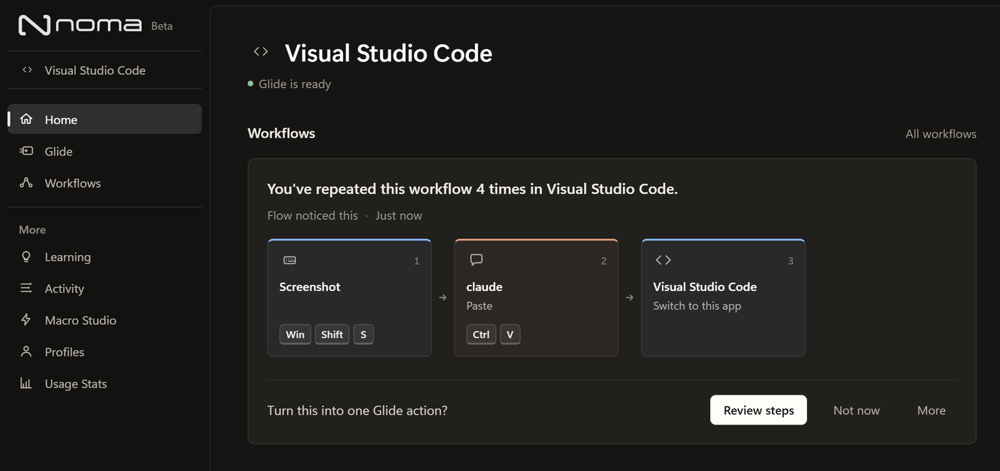
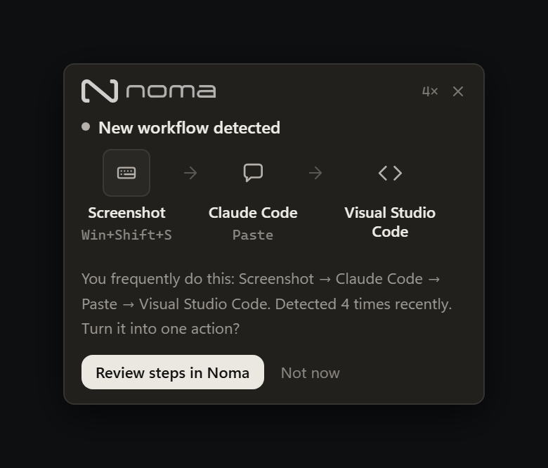
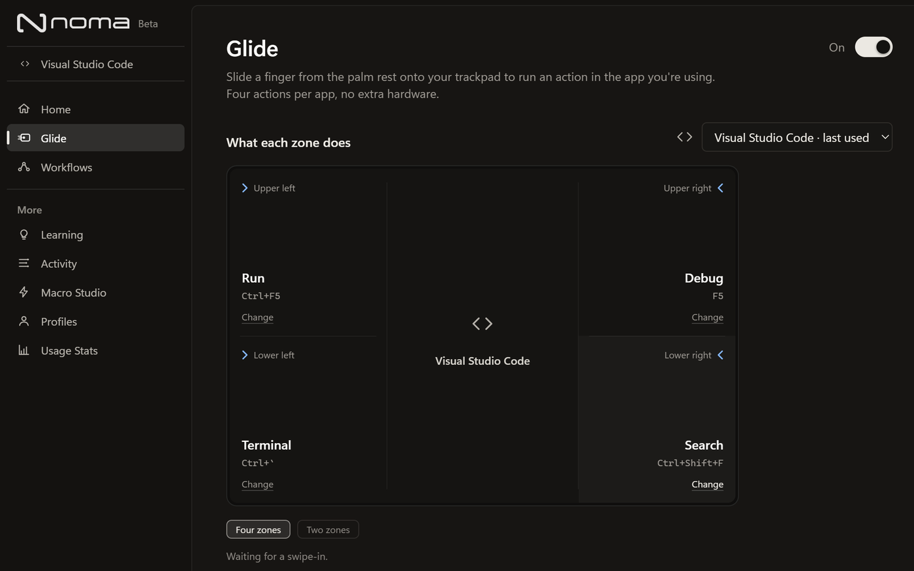

<p align="center">
  <picture>
    <source media="(prefers-color-scheme: dark)" srcset=".github/readme/banner-dark.png">
    
  </picture>
</p>

<hr>

<p align="center">
  
  
  
  
</p>

A desktop app for anyone who's on their computer a lot. It notices the
sequences you repeat across apps, like screenshot something in Chrome, paste
it into a chat, paste it into your notes, and offers to turn them into one
action.
You run that action with Glide: slide a finger from the palm rest onto your
trackpad. Noma knows which app you're in, so each app gets its own four
actions. It never records what you type.

<table>
  <tr>
    <th width="50%">Main window</th>
    <th width="50%">Workflow popup</th>
  </tr>
  <tr>
    <td></td>
    <td></td>
  </tr>
  <tr>
    <td>The app you're in and the workflows Flow has noticed there, step by step.</td>
    <td>Appears in the corner when Flow spots a workflow you keep doing. Nothing is saved until you say so.</td>
  </tr>
</table>

## Download

Get the latest beta from **[nomashift.com](https://nomashift.com)**: Windows,
Mac with Apple silicon, or Intel Mac. On Windows it updates itself; on a Mac
it tells you when a new version is ready.

The beta isn't code-signed yet. On Windows, choose **More info → Run anyway**.
On a Mac, open it once, then **System Settings → Privacy & Security → Open
Anyway**, and allow Accessibility when Noma asks.

## How it works

**Flow** watches which app is in front, which modifier shortcuts you press,
which named buttons you click, and in what order. When the same sequence
comes up again and again, it shows you the steps and asks whether to save
them as one action. Rules filter out the noise: switching windows, undoing,
or clicking through a web form are not workflows.

**Glide** turns the edges of your trackpad into four buttons. Start on the
palm rest and flick inward; the side and half you land in picks the action.
It never clicks, and normal pointer use doesn't trigger it.

<p align="center">
  
</p>

## Privacy

Everything stays on your computer. Flow keeps which app, which shortcut,
which button and when. It never keeps what you type, your clipboard,
screenshots, page titles or addresses. Browser tabs are stored only as a
scrambled fingerprint. Settings → Your data clears or deletes all of it.
Noma's only network request is checking for updates.

## In this repo

| Folder | What it is |
|---|---|
| [`Noma App`](./Noma%20App) | The product: an Electron, React, TypeScript and SQLite desktop app for Windows and macOS. Start here. |
| [`Noma Website`](./Noma%20Website) | [nomashift.com](https://nomashift.com), a separate Vite and React site. |
| [`Noma Virtual Device`](./Noma%20Virtual%20Device) | An on-screen stand-in for the Noma device (a small screen and four buttons) that talks to the app over a local connection. |
| [`Noma Device Firmware`](./Noma%20Device%20Firmware) | ESP32 firmware for the first physical prototype. Written, not yet run on a board. |
| [`Noma Software Prototype`](./Noma%20Software%20Prototype) | An early demo build used for user testing. It doesn't run real actions. |

The projects share no packages. Anything that has to match across two of
them is copied by hand and noted where it's used.

## Build from source

```bash
cd "Noma App"
npm install
npm run dev          # run the app
npm test             # tests (npm run test:mac checks the macOS paths too)
npm run typecheck
```

Releases are built by GitHub Actions when a `v*` tag is pushed. See
[`Noma App/RELEASING.md`](./Noma%20App/RELEASING.md).
